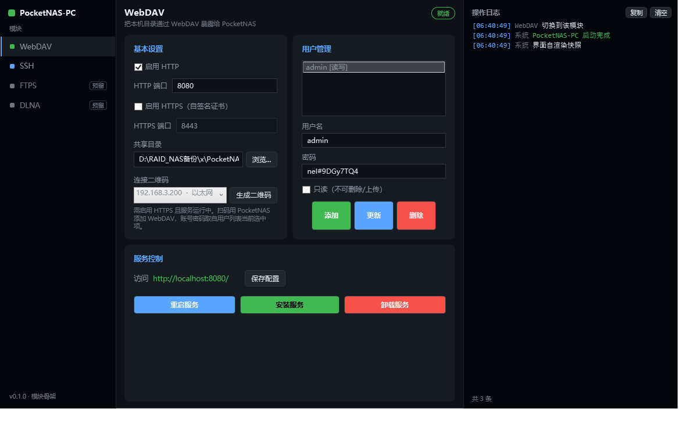
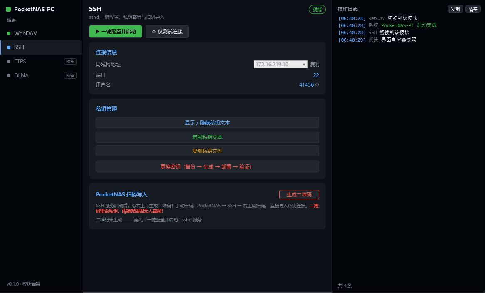

# PocketNAS-PC

PocketNAS 的 Windows 桌面端合集：把原先分散的 WebDAV 管理器和 SSH 配置助手合并成一个程序，并预留 FTPS / DLNA 模块位。

## 模块

| # | 模块 | 状态 | 来源 |
|---|------|------|------|
| ① | WebDAV | 已接入 | easy_webdav（v1.2.4） |
| ② | SSH | 已接入 | SshHelper（v1.04） |
| ③ | FTPS | 已接入 | FtpsServer（新写） |
| ④ | DLNA | 预留，方向已存档（投屏接收），未开工 | — |

## 界面

统一为「左导航 · 中内容 · 右日志」三栏，日志全局共享一份。

WebDAV 模块：



SSH 模块：



## 目录结构

```
PocketNAS-PC/
├── src/
│   ├── PocketNAS.PC/          # 外壳：窗口、导航、全局日志渲染
│   ├── PocketNAS.Shared/      # 共享层：LogService / LanAddresses / 服务管理 / 提权
│   ├── PocketNAS.Ftps/        # ③ FTPS 协议实现 + 服务助手
│   └── PocketNAS.FtpsService/ # ③ FTPS 服务宿主（Generic Host）
├── easy_webdav/               # ① WebDAV 模块（完整历史）
│   ├── src/WebDAVService/            # 服务端
│   └── src/WebDAVConfigurator/       # WebDavView（UserControl）
├── SshHelper/                 # ② SSH 模块（完整历史）→ SshView
├── docs/shots/                # 界面截图
├── AGENTS.md                  # 项目记忆：约定、硬约束、踩过的坑
└── PocketNAS-PC.sln
```

两个来源仓库以 `git subtree` 方式并入，各自保留完整提交历史。

> 动手改代码前，先读 [AGENTS.md](AGENTS.md)。那里记着不成文的约定和已经踩过的坑
> （比如为什么按钮模板不能用 `TextBlock`、为什么 FTPS 不要动）。

## 构建与运行

```bash
dotnet build PocketNAS-PC.sln -c Release
dotnet run --project src/PocketNAS.PC
```

界面自渲染快照（调试用，无参数则正常启动）：

```bash
PocketNAS-PC.exe --shot out.png --module=ssh
```

## 关键实现说明

**日志**：各模块只调 `LogService.Write(模块名, 文本, 级别)`，外壳的右侧面板统一渲染，切换模块不清空。

**提权**：WebDAV 的安装/卸载/重启服务需要管理员权限。外壳接管了 `--install / --uninstall / --restart` 参数，
以 `runas` 重启自身执行，不再依赖独立的 WebDAVConfigurator.exe。

**二维码**：两个模块都有，但都只出现在弹窗里，主界面不留含凭据的图像。

**权限**：外壳 manifest 为 `requireAdministrator`，启动即请求 UAC。两个模块都要改系统状态
（配置 sshd、写 `administrators_authorized_keys`、安装 Windows 服务），普通权限下会直接失败。

**部署**：构建时会自动把 WebDAV 服务 `dotnet publish` 到输出目录的 `service\` 子目录，
「安装服务」从那里取 `WebDAVService.exe`（单文件自包含，约 70MB）。
查找顺序为 `service\` → 程序根目录，两者都没有时会弹窗列出已查找路径。

**密码**：WebDAV 用户密码默认掩码显示，右侧眼睛按钮切换明文/掩码，旁边「随机」按钮生成
16 位强密码（大小写 + 数字 + 符号，排除 0/O、1/l/I 等易混字符，Fisher-Yates 洗牌避免位置规律）。

## Debug / Release 与配置

每个输出目录都是**自包含**的：配置按程序自身位置推算，整个目录可以整体搬走。

```
bin\Debug\net8.0-windows\service\ftps\ftps_config.json     ← Debug 的配置
bin\Release\net8.0-windows\service\ftps\ftps_config.json   ← Release 的配置
```

两份互不影响，改动 Debug 的配置不会影响 Release，反之亦然。

**唯一会跨目录的是 Windows 服务**：`WebDAVService` / `FtpsService` 都是全局唯一的，
服务指向的是**最后一次点「安装服务」时所在的那个目录**。在两个版本之间切换装服务时，
实际生效的配置会跟着切过去。

调试时如果遇到「改了配置却不生效」，先确认服务当前跑的是哪个目录：
打开「服务」管理器（`services.msc`），右键对应服务 → 属性 → 看「可执行文件的路径」。

## 提交约定

这个项目按功能持续迭代，**一个功能一个 commit**，不做「攒一批一起提交」。

**提交粒度**

- 一个 commit 只做一件事。功能 + 顺带修的文档可以合并，两个独立功能不行
- 每个 commit 都应该能独立编译通过
- 写文档、改计划单独提交（`docs:`），不要混进功能提交

**提交信息**

```
<类型>(<模块>): <做了什么>

- 关键改动点
- 关键改动点
```

| 类型 | 用于 |
|---|---|
| `feat` | 新功能 |
| `fix` | 修 bug |
| `refactor` | 不改行为的结构调整 |
| `build` | 构建、依赖、工程文件 |
| `docs` | 文档、计划、README |
| `chore` | 杂项（并入上游、清理） |

模块 scope 用 `shell` / `webdav` / `ssh` / `ftps` / `dlna` / `shared`，跨模块可省略。

**提交前**

```bash
dotnet build PocketNAS-PC.sln -c Release --nologo   # 必须 0 错误
git status                                          # 确认没有误加的产物
```

## 与上游同步

```bash
git subtree pull --prefix=easy_webdav ew master --squash
git subtree pull --prefix=SshHelper   ssh master --squash
```

> `ew` / `ssh` 两个 remote 只用于拉取：它们的 push 地址已被设为 `PUSH-DISABLED`，
> 这是刻意的——原仓库不做任何回写，误执行 push 只会报错，不会污染上游。

> 注意：并入后对两个子目录内部做了结构性改造（窗口拆为 UserControl、输出类型改 Library），
> 直接 subtree pull 上游会冲突，需要按改造后的结构手工合并。

## 首次推送到新仓库

在 GitHub 新建空仓库后（不要勾选初始化 README），执行：

```bash
cd D:/RAID_NAS备份/x/PocketNAS-PC
git remote add origin https://github.com/<你的账号>/<新仓库名>.git
git push -u origin master
```

推送前若要瘦身，可先剔除 SshHelper 历史里 62.5MB 的 `publish.zip`
（会改写 commit sha，届时 `ew` / `ssh` 的同步基线需要重新建立）。


## 已知待办

- **DLNA 模块**：未开工，方向已存档在 [docs/dlna-plan.md](docs/dlna-plan.md)
  （手机投送 → PC 接住 → 播放器读取；已否决的路线与开工前必须先回答的 4 个问题都在里面）。
- **FTPS 证书**：当前只能自动生成，无管理入口；方案存档在 [docs/ftps-cert-plan.md](docs/ftps-cert-plan.md)
  （核心是二维码下发证书指纹做 TOFU，绕开手机装证书的麻烦）。
- 状态胶囊固定显示「就绪」，尚未接真实的 sshd / WebDAV 服务状态。
- IP 选择下拉在网卡名较长时可能显示不全；单纯调大宽度会顶乱版面，
  后续考虑改成弹窗式选择器（点开列出「IP · 网卡类型 · 状态」再确认）。
- `service\WebDAVService.exe` 需在服务停止后重新发布一次（当前版本缺 ObjectDisposedException 修正）。
- 原 `easy_webdav/WebDAVService.sln` 仍存在，其中 WebDAVConfigurator 已变为类库。
