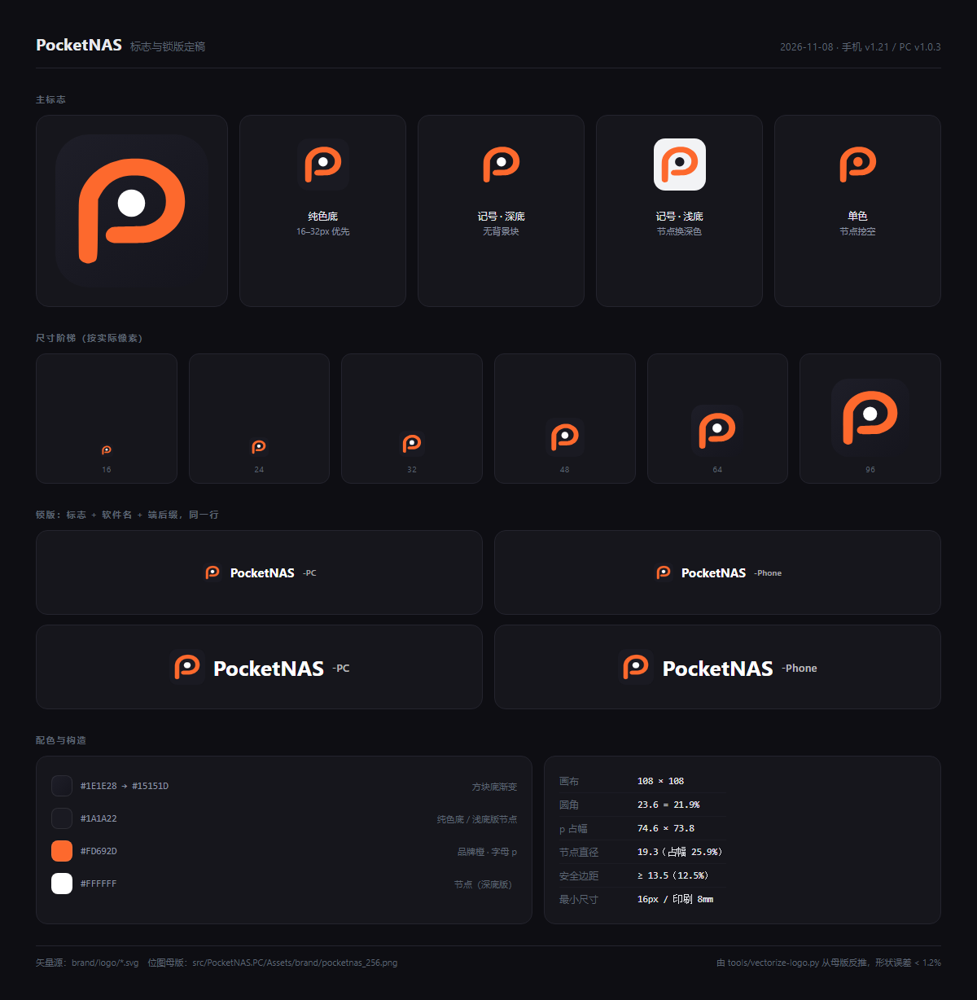

# PocketNAS 标志设计（定稿）



> 定稿于 2026-11-08，随手机 `v1.21` / PC `v1.0.3` 一起冻结。
> 本目录的 SVG 是**设计源**，`src/PocketNAS.PC/Assets/brand/*.png` 是**生产位图**，
> 两者由 `tools/vectorize-logo.py` 从同一张母版推导，形状误差 < 1.2%。

---

## 1. 概念

**小写 `p` 的竖笔一路绕回，在碗里落下一个圆点。**

- `p` = **P**ocket：口袋，也是 PocketNAS 的首字母。
- 碗里的圆点 = **节点**：一台 NAS、一个共享目录、一条拓扑上的点。
- 一笔到底不分叉 = 数据从设备直接到人，中间没有多余环节。

形状由设计原图矢量化得到（约 23 段贝塞尔），**不要手改路径坐标**；要改就改位图母版再重跑脚本。

---

## 2. 文件清单

| 文件 | 用途 | 背景 |
|---|---|---|
| `logo/pocketnas-logo.svg` | **默认版**。网页品牌行、启动图、文档头图 | 自带渐变深底 |
| `logo/pocketnas-logo-flat.svg` | 16–32px、印刷、单色场景。渐变在低分辨率下会显脏 | 自带纯色深底 |
| `logo/pocketnas-mark-on-dark.svg` | 深色界面里直接摆标志，不要方块 | 透明，配白点 |
| `logo/pocketnas-mark-on-light.svg` | 白纸、浅灰底、Word/PPT 页眉 | 透明，配深色点 |
| `logo/pocketnas-mark-mono.svg` | 水印、激光刻字、favicon 蒙版 | 透明，单色，节点挖空 |

位图母版与全套尺寸（`src/PocketNAS.PC/Assets/brand/`）：

```
pocketnas_16.png   pocketnas_20.png   pocketnas_24.png   pocketnas_32.png
pocketnas_40.png   pocketnas_48.png   pocketnas_64.png   pocketnas_96.png
pocketnas_128.png  pocketnas_256.png  pocketnas.ico
```

字标图 `wordmark-white / black / dark.png` 仍在仓库，但**网页不用**——
网页里的软件名是 HTML 文本，改字号、加 `-PC` 后缀不用重新出图（原因见 `docs/brand-and-layout.md` §1.2）。

---

## 3. 构造（108 × 108 网格）

| 项 | 值 | 占比 |
|---|---|---|
| 画布 | 108 × 108 | — |
| 方块圆角 | 23.6 | 21.9% |
| p 占幅 | 74.6 × 73.8 | 69% × 68% |
| 节点直径 | 19.3 | 占 p 宽度 25.9% |
| 最小安全边距 | 13.5 | 12.5% |

安全边距：标志四周至少留 `12.5%` 的空，任何文字、边框、其它图标都不得进入。
这是按「方块圆角 21.9%」反推的——边距再小，圆角就会被旁边的元素咬掉。

**最小尺寸**：数字界面 16px（再小节点会糊成一团），印刷 8mm。

---

## 4. 配色

| 名称 | 值 | 用在哪 |
|---|---|---|
| 方块底（渐变） | `#1E1E28 → #15151D`，135° | 默认版 |
| 方块底（纯色） | `#1A1A22` | 纯色版、浅底版的节点 |
| 品牌橙 | `#FD692D` | 字母 p，唯一强调色 |
| 节点白 | `#FFFFFF` | 深底版节点 |

品牌橙只用于标志本身和交互强调（上传按钮、选中态、进度条）。
**不要**把橙色大面积铺成背景，也不要给标志加投影、外发光、描边。

---

## 5. 用法对照

| 场景 | 用哪个 |
|---|---|
| WebDAV 网页顶栏 / 登录页 | `pocketnas_64.png`，24px（登录页 44px），base64 内嵌 |
| Windows 安装包、exe、快捷方式 | `pocketnas.ico` |
| 手机启动图标 | `app/src/main/res/drawable/app_icon.xml`（自适应图标前景层，自带安全边距） |
| README 头图、Release 封面 | `logo-sheet.png` 或 `pocketnas-logo.svg` |
| 白底文档 / 打印 | `pocketnas-mark-on-light.svg` 或 `pocketnas-logo-flat.svg` |
| 单色丝印 / 水印 | `pocketnas-mark-mono.svg` |

手机启动图标**不能**直接用主标志 SVG：Android 自适应图标要求前景内容只占画布 66%，
照搬会让图标在所有启动器里缩水一圈。两者是同一形状、不同边距，属于预期差异。

---

## 6. 禁用

1. **不要拉伸**——只能等比缩放。
2. **不要换色**——橙就是 `#FD692D`，不要改成 `#FF7A00` 之类。
3. **不要反白整个标志**——深底上用 `mark-on-dark`（橙 p + 白点），不要把方块也变白。
4. **不要加圆角以外的外框**、不要加投影。
5. **不要把 p 单独取出来当图标**——节点是概念的一部分，去掉就成了普通字母。
6. **不要在彩色照片上直接压标志**——先加一层深色半透明底，或用带方块底的版本。

---

## 7. 改标志的正确流程

```bash
# 1. 换母版：只改这一张 256px PNG（或更高分辨率的同名文件）
#    src/PocketNAS.PC/Assets/brand/pocketnas_256.png

# 2. 重建矢量源（需要 pip install potracer pillow numpy）
python tools/vectorize-logo.py

# 3. 由 256 生成全套位图尺寸与 .ico（沿用原有导出流程）

# 4. 把新标志同步进三个页面
python tools/sync-brand.py
python tools/sync-brand.py --check   # 必须退出码 0

# 5. 手机端 app_icon.xml 需另行重描（它是自适应图标前景层，不是同一份文件）
```

`tools/vectorize-logo.py --check` 只打印测量值（圆角、节点、p 占幅），用来确认母版有没有被无意改动。

---

## 8. 版本记录

| 日期 | 版本 | 变更 |
|---|---|---|
| 2026-11-08 | 手机 `v1.21` / PC `v1.0.3` | 冻结为定稿；补矢量源、单色版、浅底版；锁版统一成一行式 |
| 2026-11-05 | PC `v1.0.0` | 换新品牌图标（橙 p + 节点），补齐黑/白两套 |
