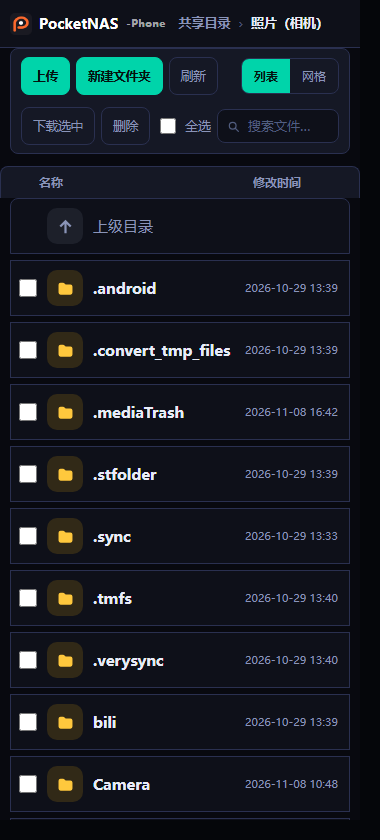
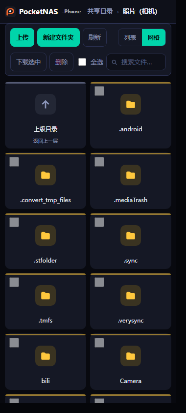
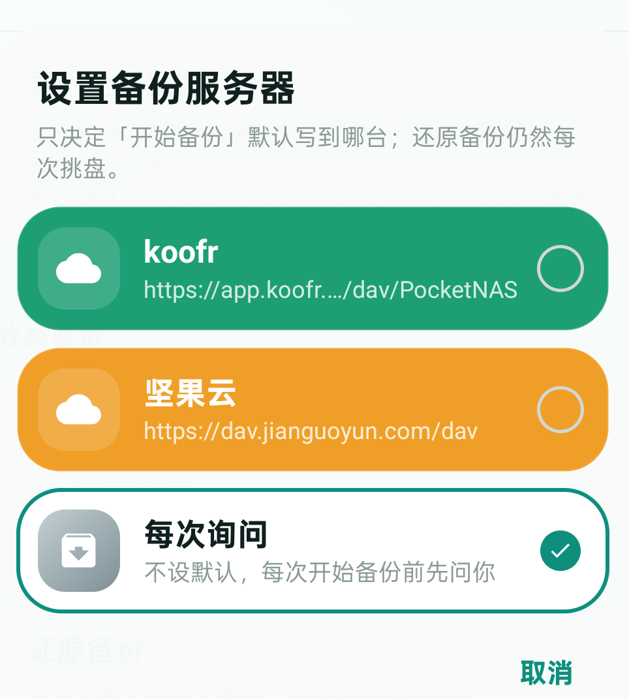
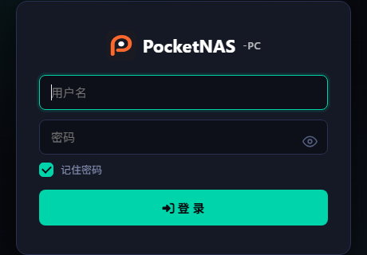

# 品牌标志与界面版面定稿

> 定稿日期：2026-11-08（PC `v1.0.2` / 手机 `v1.21` 这一版）。
> 这份文档回答两个问题：**标志长什么样、放在哪**；**WebDAV 网页那套版面到底有几块、各块管什么**。
> 以后改外观先读这里，别再从某一端的页面里猜——两端共用一份 CSS 与一张图，改错地方只会让两边越走越远。

---

## 1. 标志（Logo）

### 1.1 方块标志 `pocketnas_64.png`

一个深色圆角方块，里面一个橙色小写 `p`。

| 项 | 值 |
|---|---|
| 方块底色 | `#1A1A22` |
| 品牌橙（字母 p） | `#FD692D` |
| 圆角 | 约 22%（128px 图上 ≈ 28px） |
| 透明区 | 方块外全透明，没有白底、没有描边 |

尺寸全套（`src/PocketNAS.PC/Assets/brand/`）：

```
pocketnas_16.png   pocketnas_20.png   pocketnas_24.png   pocketnas_32.png
pocketnas_40.png   pocketnas_48.png   pocketnas_64.png   pocketnas_96.png
pocketnas_128.png  pocketnas_256.png  pocketnas.ico
```

用途：网页品牌行的小图标、安装包 / exe 图标、`ic_brand_mark`（手机首页）。
**网页里不用 ``**：PC 的服务只 serve 三个 HTML 模板，没有静态资源路由，所以品牌图必须 base64 内嵌（由 `tools/sync-brand.py` 生成）。

### 1.2 字标（wordmark）

| 文件 | 用途 |
|---|---|
| `wordmark-white.png` | 深色底上的白字版（`#F5F6F8` 主标题 + `#9AA3B2` 副标题） |
| `wordmark-black.png` | 浅色底上的黑字版 |
| `wordmark-dark.png` | 深色底、透明背景版（副标题更浅）—— 早期版本用过，**现在网页不再引用** |

**现在的网页不使用整张字标图**，只嵌方块标志，软件名交给 HTML 文本。原因写在 `brand.css` 顶部注释里：字标图里的字是「死字」，想改字号、改颜色、加个 `-PC` 后缀都得重新出图；副标题还多占一行。

字标图仍保留在仓库里，给安装包图标、宣传图这类需要「一张图说完」的场合用。

### 1.3 锁版（一行式）

```
[方块标志] PocketNAS -PC        ← PC 端
[方块标志] PocketNAS -Phone     ← 手机端
```

| 位置 | 标志 | 软件名 | 后缀 |
|---|---|---|---|
| 网页顶栏 | 24px | 15px / 700 / `#fff` | 10px / 600 / `#fff` / 62% 不透明 |
| 登录页 | 44px | 26px / 700 / `#fff` | 13px / 600 / 70% 不透明 |
| 窄屏（≤768px） | 22px | 14px | 同顶栏 |

规则：

- 三者**同一行**、垂直居中对齐，间距 10px；登录页整体居中（`.brandRow`）。
- 后缀**不加底色小签、不加边框**，就是一行白字里明显小一号的那一段。
- 除登录页外，**所有页面顶部都要有这一行**：包括虚拟根（多目录共享首页）和带 `?k=` 直链令牌的目录页。


---

## 2. 版面（WebDAV 网页，手机与 PC 同一套骨架）

改版前手机端有**两套**版面在跑（经典页 / 新版），虚拟根还另写了一套浅色清单页，同一个软件里三种长相。现在只有一套，两端的每一块位置、顺序、类名都对齐。

### 2.1 从上到下的六块

| # | 区块 | 内容 | 手机 | PC |
|---|---|---|---|---|
| 1 | 顶栏 `header` | 品牌锁版 · 面包屑 | 面包屑在品牌右侧，横向可滚 | 面包屑独立一行 |
| 2 | 工具条 `.bar` | 上传 · 新建文件夹 · 刷新 · 下载选中 · 删除 · 全选 · 计数 · 列表/网格 · 搜索 | 两行硬分行，搜索框独占一行 | 单行 |
| 3 | 表头 `.lHead` | 勾选 · 名称 · 类型 · 大小 · 修改时间 · 操作 | 窄屏只留勾选+名称+时间 | 同左，窄屏藏操作列 |
| 4 | 文件区 | 列表 `.row` / 网格 `.cell` | 见 §2.3 | 同 |
| 5 | 状态栏 `.stBar` | `N 项` · 路径 | 同 | 同 |
| 6 | 上传面板 | 拖拽/选择、进度 | 同 | 同 |

**虚拟根**（`/dav/`，多目录共享首页）不再单写页面：它把每个共享目录当成一行「文件夹」，走同一个 `render()`，只是标题固定为「共享目录」、`writable=false`（没有上传/新建/删除）。

### 2.2 列表 / 网格

- 切换控件是工具条里的 `.seg`（分段按钮），默认**列表**；`?view=list|grid` 直接指定，选择记在本地。
- 切换只换**文件区**，顶栏、工具条、表头位置一律不动——这是「切一下别整版变样」的硬要求。
- 网格卡片：52px 图标块在上，文件名在下，选中态带青色描边。

### 2.3 文件图标

不再用 emoji（不同机型渲染成彩色贴纸，且大小不齐）。现在是**彩色圆角方块 + 单色 SVG**，配色与 PC 的 `.ic-*` 一致：

| 类型 | 方块底色 | 图形 |
|---|---|---|
| 目录 | `#FFC83D` | 实心折页文件夹 |
| 图片 | `#F368E0` | 纸页 + 挖空山景 |
| 视频 | `#FF7979` | 纸页 + 挖空播放三角 |
| 音频 | `#A29BFE` | 纸页 + 挖空音符 |
| 文档 | `#2ED8A3` | 纸页 + 横线 |
| 代码 | `#74D9F5` | 纸页 + `</>` |
| 压缩 | `#FFA502` | 纸页 + 拉链 |
| PDF | `#FF6B81` | 纸页 + `P` |

「挖空」用 SVG 的 `fill-rule:evenodd`，露出方块自身底色，所以和 PC 的 Font Awesome 观感一致，但不依赖外网字体（局域网离线也能显示）。

方块尺寸：列表行 44px（窄屏 36px）、网格卡片 52px、圆角 9–14px。

---

## 3. 单一真源与同步

```
easy_webdav/src/WebDAVService/web/brand.css                ← CSS 唯一真源
src/PocketNAS.PC/Assets/brand/pocketnas_64.png             ← 图片唯一真源
        │
        ├─ tools/sync-brand.py ─→ PC  web/browse.html     （顶栏 + 内嵌登录视图）
        │                      ─→ PC  web/login.html      （登录页大号）
        │                      ─→ 手机 BrowsePages.kt     （BRAND_CSS / BRAND_ICON）
```

```bash
python tools/sync-brand.py          # 同步三处
python tools/sync-brand.py --check  # 只校验，不一致就非 0 退出（提交前跑）
```

脚本按 `/* <pnsBrandCss> */` 定界整块替换，**幂等**：跑第二次全部输出 `unchanged`。
不要在页面或 Kotlin 里手改生成块——下一次同步会覆盖掉。

---

## 4. 顺手定下来的几条规矩

1. **一个页面只有一个 header**。之前虚拟根和子目录页各自渲染过一次顶栏，切页时会出现两条品牌行。
2. **`.up` 是「上传」按钮的类名**，父级目录行不能用它（撞了会把整行染成青底、字看不见），父级行用 `.updir`。
3. **目录名不拼尾部 `/`**：交给文件夹图标表达；面包屑里才带分隔符。
4. **登录页的两个入口**（独立 `login.html`、浏览页内嵌登录视图）用同一套标志与布局，`-PC` 后缀位置一致。
5. **「记住密码」勾选框**：勾上 = Cookie 带 30 天过期、会话 30 天；不勾 = 会话 Cookie，关浏览器失效。以前不分勾否都写死 1 天，等于强制记住。

---

## 5. 定稿截图

手机（PHW110 实机抓取，按 360px 宽渲染）：

| 列表 | 网格 |
|---|---|
|  |  |

备份服务器选择（卡片式，与服务器列表同一套观感）：



PC 登录页：


